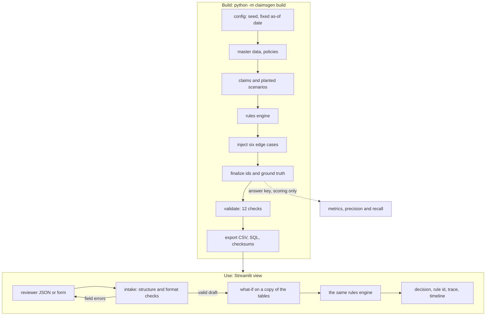

# YottaFlex-ASG

A working claims workflow plus its test bed. A rules engine takes insurance claims through intake, coverage validation,
document request, eligibility and settlement routing, with a rule ID, a reason and an append-only history behind every
decision. A deterministic generator produces the dataset (11 core entities plus five event and link tables make 16 input tables, and a separate ground-truth table makes 17; 2,000 policies, 1,000 claims, 5 claim types) with six
labelled edge cases and a separate answer key, so the workflow can be checked end to end. A minimal view exposes the
decisions, exceptions, per-claim timeline and metrics.

All data is fully synthetic ([SOURCE_MANIFEST.md](SOURCE_MANIFEST.md)). Scope and decisions: [docs/SPEC.md](docs/SPEC.md),
[docs/DESIGN.md](docs/DESIGN.md), [docs/BRIEF_VS_PLAN.md](docs/BRIEF_VS_PLAN.md).

## Results at a glance

Full scale (seed 20261022, 2,000 policies, 1,000 claims, 24,551 rows in the 16 input tables; derived from a fresh build and `metrics.md`):

- **Outcomes:** 70.3% approved, 15.3% denied, 4.0% waiting for documents, 6.4% under review, 4.0% not yet assessed at the as-of date.
- **Proof:** validation flags exactly the 30 planted defects (4 in the starter), a same-seed rebuild is byte-identical, and `pytest -q` runs 340 tests.
- **Workflow:** 69.3% of assessed claims are straight-through (no pend, no review); 30 claims (3.0%) are referred as suspected fraud; 12.0% of approved settlements need the approver.
- **Honest misses:** recall is 0.90 to 0.97 for lapsed policy, outside coverage period, duplicate, incomplete evidence and boundary-on-start (recent claims are not assessed yet); `claim_over_limit` precision is 0.81. Fraud scores 1.00 only because its labels are planted ([why](docs/DESIGN.md)).

## Units and basic terms

The same table is shown in the app under "Read first: units and basic terms".

| Term | Meaning here |
|---|---|
| Currency | USD. Tables show exact amounts with two decimals (1250.00); the engine counts in whole cents, so there is no rounding drift. |
| Dates | ISO `YYYY-MM-DD`. "Today" is fixed at **2026-10-22** (never the real clock), so every run gives the same answer. The what-if tab evaluates up to 2026-11-21 or later. |
| Claim types | AUTO, HOME, HLTH (health), TRVL (travel), LIAB (liability). Policy ids look like `POL-AUTO-2026-000001`, claims `CLM-2026-000001`. |
| Limit | The most a coverage pays in total on a policy. Earlier claims use it up, so a later claim can be paid only the remaining limit. |
| Deductible | The part of each claim the customer bears first. Payable = min(max(0, eligible amount - deductible), remaining limit) (R-PAY-01). |
| Reserve | Money set aside: an estimate at first notice (R-RSV-01), revised to the payable when the claim is decided (R-RSV-02). |
| Documents | Each claim type has mandatory documents. One must arrive within 5 days of submission or the claim waits in `docs_pending` (R-DOC-01). |
| Decisions | `approve`, `deny`, `pend_docs` (waiting for documents), `refer_review` (a person must look: duplicate or suspected fraud). |
| Statuses | submitted, docs_pending, assessed, approved, paid, denied, under_review. Status changes are appended to a history, never overwritten. |
| Approval | Payable above 30,000 USD goes to the approver role; otherwise the process owner (R-APR-01). |
| Fraud score | Flags divided by 4 (new policy, many recent claims, near-limit amount, late report); at or above 0.5 the claim is referred (R-FRD-05). |
| Rule ids | R-COV coverage, R-ELG eligibility, R-DOC documents, R-FRD fraud, R-PAY payment, R-RSV reserve, R-APR approval. Every decision names one. |
| Data | Fully synthetic, seed 20261022. The starter is 100 policies and 50 claims; the full set is 2,000 and 1,000. Answers (ground truth) are used only to score the engine, never to decide a claim. |

## Run it in a container (no Python setup)

Only Docker is needed, not Python and not a git clone: Docker fetches the repository itself.

```
docker build -t yottaflex-asg https://github.com/hiox2004/YottaFlex-ASG.git
docker run --rm -p 8501:8501 yottaflex-asg                 # the view at http://localhost:8501
docker run --rm yottaflex-asg pytest -q                    # the tests
docker run --rm yottaflex-asg python scripts/verify.py     # the reproducibility proof
```

(From a local clone, build with `docker build -t yottaflex-asg .` instead.)

Or with compose (same image, port from `.env.example`): `docker compose up --build`, then `docker compose run --rm app pytest -q` for the tests.

CI builds this image on every push, runs the proof inside it and checks that the view serves. The image installs the optional extras
(Streamlit and the test tools), so it is larger than the core, which has no third-party runtime dependencies. Versions are pinned in `constraints.txt` (what the build resolved on 2026-11-01), so the image and CI are repeatable; the generated data does not depend on them. There is no hosted demo: the
project runs locally or in this container, and the starter dataset and its reports are committed in `output/starter/`.

## Five-minute tour

```
git clone https://github.com/hiox2004/YottaFlex-ASG && cd YottaFlex-ASG
python -m venv .venv                           # create it once
# then activate it:
#   macOS/Linux:        . .venv/bin/activate
#   Windows PowerShell: .\.venv\Scripts\Activate.ps1   (if scripts are blocked: Set-ExecutionPolicy -Scope Process Bypass)
#   Windows cmd:        .venv\Scripts\activate.bat
pip install -e ".[dev,ui]"                     # needs Python 3.11+ (CI uses 3.12)
pytest -q                                   # tests incl. a headless run of the app
python scripts/verify.py                    # builds twice, compares every file (rows + SHA-256)
python scripts/verify.py 1.0                # same proof at the full 2,000 policies / 1,000 claims, about 15 s
streamlit run app.py                        # the view
```

1. Open `output/starter/` (small, committed): `README.md`, `validation_summary.md`, `metrics.md`, `ground_truth.csv`.
2. Run the view. A four-number strip (claims, straight-through rate, open exceptions, seed and checksum) sits above the tabs, and the default example claim is already decided on load, with a five-stage strip (Intake, Coverage, Documents, Eligibility, Routing) showing where it passed or stopped. Tabs: Submit a claim (fill in a form or load one of seven examples, watch the whole workflow decide it, request missing documents; template in [docs/CLAIM_INPUT.md](docs/CLAIM_INPUT.md)), Decisions (rule, reason, actor per claim), Exceptions, Claim timeline (append-only history, a rule trace showing where a claim stopped and why, and what would make it payable), Metrics (rates, cycle times, amounts blocked, money effect by rule, straight-through (no exception) rate, approver workload, docs-pending aging, reserve vs final, threshold sensitivity, precision/recall), Realism (distributions) and Reproducibility (fixed seed, dataset checksum, rebuild-and-compare) and Quality and data (validation checks, planted defects vs flagged, answer key, data dictionary, rule catalogue, table browser).
3. Regenerate anything with the command below; the same seed always gives byte-identical files.

## Generate data

```
python -m claimsgen build --scale 1.0 --out output/full      # 2,000 policies / 1,000 claims (gitignored)
python -m claimsgen build --scale 0.05 --out output/starter  # starter: 100 policies / 50 claims (committed)
python -m claimsgen all --out output                          # both
```

Supported scales: 0.05 (the starter) or 0.075 to 5.0. Anything else is refused with a one-line error (exit code 2): below that range the injected test cases cannot be placed (0.051, 0.055 and 0.07 fail too), and above it the build gets slow.

Lightweight path: the generator, engine, validation and metrics have no third-party runtime dependencies (`pip install -e .` is enough; the Streamlit view and the tests are optional extras `ui` and `dev`), so everything above runs without the UI.

Seed fixed at 20261022, "today" fixed at 2026-10-22 (never the system clock), currency USD. Each package contains CSV and
JSON for the 16 input tables, `seed.sql` (SQLite, foreign keys), `ground_truth.*` (separate answer key), data dictionary,
schema, validation summary, metrics, manifest and checksums. The exit code is non-zero if validation does not flag exactly
the planted defects or a same-seed rerun differs.

## How the workflow decides

Decision order (first failing step ends the path): coverage (R-COV-01 claim after start, R-COV-02 policy in force,
R-COV-03 incident inside coverage dates) -> duplicate (R-ELG-03) -> documents (R-DOC-01, pend until received) ->
fraud flags (R-FRD-05, score >= 0.5 goes to review) -> coverage terms (R-ELG-01: item and incident type must be covered by the item's coverage) -> exclusions (R-ELG-02) -> payable per coverage
(R-PAY-01: eligible minus deductible, capped at the remaining limit) -> reserve (R-RSV-01 at submission, revised by R-RSV-02) -> approval authority
(R-APR-01: above 30,000 USD needs the approver). Every state change is a new row in `claim_status_history` with actor role,
rule ID and reason. The catalogue is `src/claimsgen/rules.py`.

## How we know it works

- **Validation:** 12 checks (about 309,000 row-level checks over the 24,551-row dataset); zero failures on the clean baseline, and after injection the failing ids are exactly the planted integrity defects.
- **Independent payable check:** `tests/payable_reference.py` re-implements the payable rule from the spec text (it does not import `rules.py`) and is compared with the engine on hand-computed cases and on every approving claim.
- **Fraud row caveat:** the fraud labels are the planted indicator pattern (an early claim near the limit), so the `suspected_fraud` precision and recall check rule consistency; they are not a fraud-detection accuracy.
- **The evaluation can fail:** mutation tests (`tests/test_mutation.py`) break one rule at a time and assert that recall, precision or amounts move.
- **Injection is contained:** every non-target claim is identical before and after injection (`tests/test_injection_isolation.py`).
- **Intake is exercised through the real app:** seven example claims, each tested to reach its intended rule at starter and full scale (`tests/test_intake_examples.py`, `tests/test_app_intake.py`); validation checks structure, format and sanity bounds (see [docs/CLAIM_INPUT.md](docs/CLAIM_INPUT.md)); every business outcome is decided by the rules.
- **No leakage, byte-stable output:** label columns are rejected in inputs, and two same-seed builds are byte-identical (`scripts/verify.py`, run in CI at the starter scale and at the full volume).

## Realism and calibration

Reference ranges are approximate, snippet-level public figures (sources and URLs in [docs/review/research/insurance-realism.md](docs/review/research/insurance-realism.md)); they set plausible ranges, they are not fitted targets. Every value below is from a fresh full-scale build.

| Metric | This dataset | Reference | Status |
|---|---|---|---|
| Claimed amount, median per claim (USD) | AUTO 6.2k, HOME 10.1k, LIAB 19.4k, HLTH 4.4k, TRVL 3.3k; 3.9% of claims denied as within the deductible | auto collision 3.8k to 10k; general liability mean about 78k; trip cancellation about 1.5k | calibrated per coverage (medians, not the liability mean) |
| Approver share of approved settlements | 12.0% above 30,000 USD | none; band of 8-15% chosen so the approver path is exercised | hand-chosen |
| Reporting lag (days) | median 2, p90 14, max 120; 1.9% over 60 days | none used | hand-chosen shape, long tail |
| Fraud flags (share of claims) | F1 16.7%, F2 0.4%, F3 7.0%, F4 1.9%; referrals 3.0% | special-investigation referral about 3-10% | in range; the labels are planted |
| Submission to paid, median days | HLTH 9, AUTO 11, TRVL 12 (10 claims), HOME 20, LIAB 20 | repairable auto about 19, homeowners about 41 | ranked like the benchmarks, faster than real life |
| Straight-through rate | 69.3% (no exception; every decision is automated) | 10-20% of a blended book (vendor figures) | not comparable |
| Claims per policy-year | 0.90 (1,000 claims over about 1,111 policy-years) | auto collision about 0.05 | fixed by the brief, more than 10x a real book |
| Policies not in force at the as-of date | 26.3% (13% lapsed or cancelled, the rest ended by term) | annual auto retention about 78-82% | plausible, not modelled further |
| Not modelled | investigation and negotiation time, document-chase closure, reopen and appeal, reserve development beyond two steps (an FNOL reserve at submission, one revision at the decisive assessment; no later development) | | stated limits |

## Where to verify the review points

| Point                                   | Evidence                                                                                                                   |
| --------------------------------------- | -------------------------------------------------------------------------------------------------------------------------- |
| a. Distributions                        | `validation_summary.md` distributions section; `tests/test_claims.py`                                                  |
| b. IDs and joins                        | `tests/test_ids.py`; validation checks (ID format, foreign keys)                                                         |
| c. Lifecycle                            | validation date-order and lifecycle checks; `rules.TRANSITIONS`                                                          |
| d. Derived values                       | validation arithmetic replay (`checks_business.py`)                                                                      |
| e. Normal, boundary, failure, exception | six injected cases and four boundary cases, counted in `validation_summary.md`; `tests/test_inject.py`                 |
| f. Ground truth separate                | `ground_truth.*` at the top level; inputs carry schema columns only (`tests/test_inject.py`, leakage check)            |
| g. Reproducibility and provenance       | `python scripts/verify.py`; reproducibility table in `validation_summary.md`; `checksums.sha256`; SOURCE_MANIFEST.md |

Evaluation metrics (outcome rates, cycle times, amounts blocked, reserve vs final, precision/recall of the engine and the
validator against the answer key) are in each package's `metrics.md` and the view's Metrics tab.

## Assumptions we made explicit

- Product codes AUTO, HOME, HLTH, TRVL, LIAB, one per claim type. `ASN` is read as the adjuster assignment record;
  Assessment is `ASM-...`. `DOC-<claim-id>-001` is literal: `DOC-CLM-2026-000001-001`.
- Claim date means submission date; the incident date is separate. The 1,000 claims include duplicates and anomalies.
- Injected rows are 15 per case at full scale (within the 10-30 target); the starter has 2 per case.
- Baseline conditions (lapsed, outside coverage, incomplete evidence, over limit, fraud indicators, duplicates, an item type the coverage does not list) are produced
  by the rules and labelled `origin=baseline`; the six mandatory cases are `origin=injected`.

- Policy IDs use one serial counter across products: `POL-HOME-2026-000004` can be the first HOME policy. The `2026` in IDs is the
  series year, not a date; policy dates run 2024-2026.
- Requesting documents has no table of its own: it is recorded as a `pend_docs` assessment (R-DOC-01) listing the requested types in
  `assessment.missing_doc_types`, plus a `docs_pending` event in `claim_status_history`.

## Architecture



The engine is one set of pure rule functions (`rules.py`, `decide.py`, `engine.py`) used twice: to decide the generated claims and to decide a claim a reviewer submits. The answer key (`ground_truth`) never reaches the engine; it is read only by the scoring step. Per-module notes are in [docs/study/](docs/study/README.md).

## Design trade-offs

| Decision | Chosen | Alternative | Why | Cost |
|---|---|---|---|---|
| Decision logic | Deterministic rules, every outcome cites a rule id | An LLM decides | Exact scoring against the answer key, same input gives the same output, audit trail by construction | Cannot read free text yet (see "Where AI would go next") |
| Storage | CSV and SQL files, byte-stable, with checksums | PostgreSQL with migrations | No setup, diffable, reproducibility is provable by comparing hashes | No concurrent writers, no row-level security or tenants (one synthetic dataset) |
| Input validation | Standard library, every problem reported at once | Pydantic schemas | The core stays free of third-party dependencies | Checks are hand-written; [docs/CLAIM_INPUT.md](docs/CLAIM_INPUT.md) is the contract |
| Submitted claims | What-if on a copy; nothing is saved | Persist them into the dataset | The dataset stays valid for scoring; no state to corrupt | Results disappear when the page reloads |
| Execution | Synchronous, in process (full build about 6 seconds) | Queue and workers | Simpler, deterministic ordering of claims | Not horizontally scaled |
| Interface | One Streamlit file, logic in tested modules | HTTP API plus a frontend | Fast to review and run | No HTTP contract yet; the modules can sit behind an API unchanged |
| Realism | Calibrated to stated ranges, misses reported | Uniform random data | Shows the engine's honest limits | Some classes score below 1.00 |

## Security and governance

- **No personal data, no secrets:** all data is generated ([SOURCE_MANIFEST.md](SOURCE_MANIFEST.md)); the project needs no keys, accounts or network access at run time; `.env*`, databases and local agent settings are git-ignored; the prompt-history export redacts paths, e-mails and tokens.
- **Untrusted input:** the intake validates structure before any rule runs: 50,000-character limit, at most 20 items and 20 documents, strict ISO dates from 1900-01-01, amounts in cents with at most two decimals, duplicate JSON keys rejected, nesting depth limited. Hostile inputs are tested (`tests/test_intake.py`).
- **No prompt-injection surface today:** no model sits in the decision path. If an extraction model is added, its output is only a draft claim that goes through the same validator and a person's confirmation; the rules, not the model, keep the final say.
- **Governance:** every decision names a rule id and a reason code; status changes are appended to a history and never overwritten; the answer key is separate from the inputs; one test fails if an input table gains a label column.
- **Supply chain and container:** dependency versions are pinned (`constraints.txt`), the image runs as a non-root user with a health check, and CI rebuilds it on every push.

## Interfaces

| Interface | Contract | Errors |
|---|---|---|
| Claim intake (view, JSON) | Template and field rules in [docs/CLAIM_INPUT.md](docs/CLAIM_INPUT.md) | A list of `{"field", "message"}` pairs, all problems at once; nothing is evaluated on error |
| Generator CLI `python -m claimsgen build --scale S --out DIR` | Scale 0.05, or 0.075 to 5.0; the seed is fixed by the brief | One-line message and exit code 2 for a bad scale |
| Proof `python scripts/verify.py [scale]` | Builds twice and compares every file | Non-zero exit if any file differs or the validator does not flag exactly the planted defects |

There is no HTTP API by design: this is a reviewer-run test bed and workflow, not a hosted service.

## Known limits (stated, not hidden)

- Intake accepts structured claims only (a form or JSON in the documented template). There is no free-text or document extraction, by choice: intake and the decision path are fully deterministic, so accuracy cannot drop at the intake step; the cost is that messy real-world input would need a separate adapter.
- The validator replays derived amounts through the same `rules.payable` function the engine uses: it is an independent
  replay of the inputs, not an independent implementation of the formula. `tests/payable_reference.py` is the independent
  reimplementation from the spec text, checked against the engine on hand-computed fixtures and on the full dataset.
- Very recent claims are honestly left in an earlier status when the next step would fall after the as-of date, and count as
  misses in recall. `claim_over_limit` precision is below 1 (0.81) because the limit is an annual total per coverage: a later ordinary claim on a policy whose limit an earlier claim already used up is also decided `limit_reached`.
- `under_review` is terminal in this dataset. The reserve is set at submission (claimed, capped at each coverage limit) and revised once at the decisive assessment; there is no later reserve development.
- There is no document-chase SLA or closure: a claim in `docs_pending` or `under_review` stays there unless documents arrive.
- Duplicate detection matches the exact incident date only; a copy with the date shifted by one day is not caught (real carriers match within a window).
- `adjuster.max_open_claims` is part of the spec'd schema but not used: assignment picks an adjuster of the claim's specialty from a per-claim random draw, with no capacity scheduling (loads are uneven).
- The `SET-...-002` second payment is an unavoidable marker of the paid-twice case.
- The optional LLM extension is not built; the dataset and workflow are fully deterministic.
- The approver threshold (30,000 USD), fraud cutoff (score 0.5), the 30/90/60-day fraud windows and the document window (5 days) are hand-chosen constants in `src/claimsgen/config.py`, not fitted to data.
- There is no reopen or appeal flow: `denied` and `under_review` claims are final in this dataset.
- The four fraud flags (early claim, repeated claims, amount near the limit, late reporting) are simple heuristics, combined as flags divided by 4, not a trained model.

## Why there is no AI inside the product

AI built this project; it does not run inside it. On purpose:

1. **The evaluation needs exact answers.** A separate answer key, the same seed giving the same bytes, and precision and recall against planted cases only mean something if the decisions repeat exactly. A model in the decision path would make outcomes vary between runs and the scores approximate. Rules make them exact, and every decision cites a rule id.
2. **Coverage and payment decisions need an audit trail a person can check.** "The model judged so" is not a reason; "R-PAY-01: eligible minus deductible, capped at the remaining limit" is.
3. **Free and local only.** The FAQ asks for free or locally runnable services. There are no keys, accounts or network calls at run time, and a reviewer runs one Docker command.
4. **Leaving AI out of intake costs no accuracy.** The claim form is structured and validated, so a model would add risk without adding information. Free text and scans are where a model would help, and that is the extraction layer in "Where AI would go next".
5. **Knowing where AI belongs is part of the job.** It belongs at the edges (extraction, summaries, document triage), with a person confirming and the rules keeping the final say, scored against the answer key. It does not belong in the middle of the decision.

## Where AI would go next

Not built: the dataset and workflow are deterministic by choice, so the evaluation is exact. Where a model would help, in order:
1. An extraction layer in front of intake: real claims arrive as ACORD loss notices, 837 files, portal forms, emails and scans, not as our JSON. Structured formats get a deterministic field mapper first (exact, free, testable). A cheap model is used only for free text and scans the mapper cannot read, and its output is a draft claim a person confirms. Either way the draft goes through the same `intake.parse_and_validate` and the same rules, and extraction is scored field by field against the generator's ground truth.
2. Adjuster summaries: a short narrative of each decision, checked against the rule trace so it cannot cite a rule that did not fire.
3. Document triage: classify uploads and flag likely rejections before the R-DOC-01 check.
4. Cost and privacy: a local model on the claim text, no personal data leaving the machine, a fixed prompt version logged per decision, and the rules (not the model) keep the final say.

## AI use and prompt history

`ai-transparency/` records which AI tools and models were used, where they helped, what was verified, and the limits of that record;
`ai-transparency/prompt-history/` holds the prompts (generated by `python scripts/export_prompts.py`, redacted for paths, e-mails and tokens).

## Repository map

`src/claimsgen/` generator, rules engine, validation, injection, export, metrics, view data · `app.py` the view ·
`scripts/` verify and helpers · `tests/` · `docs/` spec, design, data dictionary, schema · `docs/study/` a living study
guide (one note per module, glossary, an end-to-end claim walk-through, change log) · `CONTRIBUTING.md` commit format.
